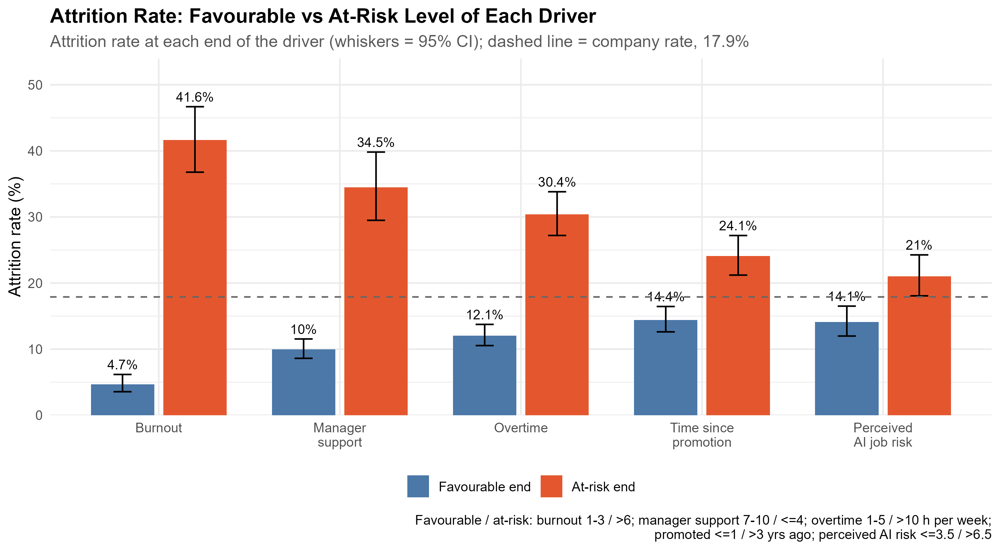
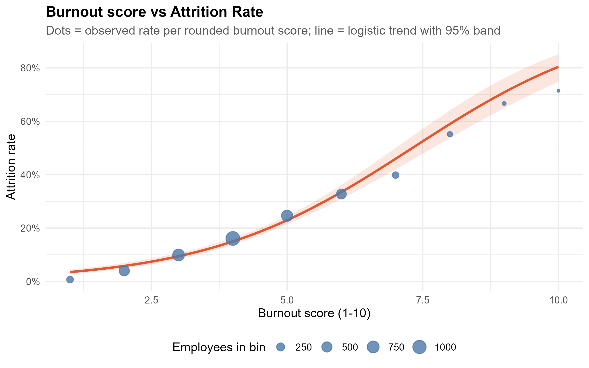

# Employee Attrition in the Age of AI

Exploratory analysis of employee attrition for Insight Partners. The analysis asks:

> **In an age of AI, does it affect employee attrition? What factors drive employee attrition, how do they interact, and where should retention efforts be focused?**

The work audits and cleans the source data before comparing leavers and stayers, examining correlations, and identifying early-warning indicators.

## Headline findings

- **Burnout and manager support are the strongest practical signals.** The largest favourable vs at-risk attrition gaps are for burnout (**4.7% vs 41.6%**) and manager support (**10.0% vs 34.5%**).
- **Burnout has a nonlinear relationship with leaving.** Attrition remains below 20% through approximately burnout score 4, then rises sharply, reaching roughly 70% at the highest scores.
- **AI job-risk perception is not the primary standalone signal.** Its correlation with attrition is weak (**r = 0.08**) and its favourable-versus-at-risk gap is smaller (**14.1% vs 21.0%**). It appears to amplify existing strain, particularly among highly burned-out employees.
- **Risk is concentrated.** Approximately 17.5% of employees have at least two early-warning flags, but they account for about 35% of leavers. The flags are high burnout, low manager support, a long time since promotion, high overtime, and high perceived AI job risk.
- **Retention actions should be targeted.** Start with manager support and workload control, then pilot department-specific interventions in Customer Support and Sales. Validate the warning thresholds on new data before using them operationally.

## Best figures

### The largest driver differences are burnout and manager support



The grouped comparison shows that burnout and manager support separate leavers from stayers more clearly than perceived AI job risk. Error bars show 95% confidence intervals and the dashed line is the overall company attrition rate.

### Attrition rises sharply after the burnout threshold



The observed rates and logistic trend indicate that risk is concentrated among employees with high burnout rather than spread evenly across the workforce.

Additional generated figures are available in [`figures/`](figures/):

- [`fig1_correlation_heatmap.png`](figures/fig1_correlation_heatmap.png) — correlations among continuous variables
- [`fig4_early_warning_flags.png`](figures/fig4_early_warning_flags.png) — attrition by number of warning flags
- [`fig5_burnout_panels.png`](figures/fig5_burnout_panels.png) — burnout, AI-risk, and performance segments
- [`fig6_department_heatmap.png`](figures/fig6_department_heatmap.png) — department-level attrition and risk profile

## Data quality and preparation

The raw data audit identified 37 duplicate rows, 52 rows with missing or invalid values, 46 tenure inconsistencies, and 673 remote employees with non-zero commute minutes. The analysis:

- removes exact duplicate rows;
- imputes missing or invalid values rather than dropping affected employees;
- uses median imputation for right-skewed monthly income;
- raises total working years where it is below tenure, preserving the tenure signal; and
- flags, but does not use, remote commute minutes because they may reflect occasional office visits.

Cleaning changed the headline attrition rate by only **-0.03 percentage points**, and the largest change in a driver correlation was **0.010**.

## Running the analysis

### Requirements

- [R](https://cran.r-project.org/) (tested with a current R installation)
- The [`tidyverse`](https://www.tidyverse.org/) package
- The private dataset used by the analysis

Install the package once in R:

```r
install.packages("tidyverse")
```

The source dataset is not included in this public repository. Before running the script, open [`Attrition Analysis.R`](Attrition%20Analysis.R) and set the `url` value near the top of the file to an accessible CSV path or URL:

```r
url <- "path/to/your/employee_attrition.csv"
```

Then run from the repository root:

```r
source("Attrition Analysis.R")
```

Or run non-interactively from a terminal:

```bash
Rscript "Attrition Analysis.R"
```

The script creates or updates:

- `figures/` — analysis plots as PNG files;
- `tables/` — audit, cleaning, descriptive-statistics, driver-test, and suitability CSVs; and
- `clean_attrition_data.csv` — the cleaned analysis dataset.

The script uses a fixed random seed (`1234`) so any random operations are reproducible.

## Interpretation and limitations

This is an exploratory, cross-sectional analysis. It shows **associations, not causes**. In particular, the dataset has no leave dates or longitudinal history, so it cannot establish whether burnout, management support, or AI concerns caused an employee to leave, or determine the timing of those changes.

Other limitations include:

- burnout, engagement, work-life balance, and manager support overlap, making individual effects difficult to isolate;
- no employee has a performance rating of 1, limiting conclusions about the lowest performance category;
- the data dictionary includes a non-binary gender category, but no observations are present for that group;
- some department-by-work-mode cells are small and therefore have wide uncertainty; and
- early-warning thresholds were developed on this same sample and require validation on new data before deployment.

The findings should therefore guide targeted retention experiments and further data collection, not be used as a causal explanation or an automated decision rule.